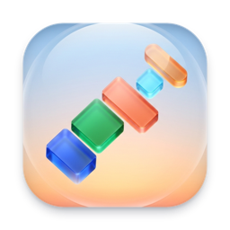

<div align="center">



# Rising Kit

**매일 쓰는 맥 유틸리티를 하나로** — 창 정렬 · 디스플레이 배치도 · 런처 · 날씨 · PDF 변환 · 음량 균형

Magnet, Raycast, Balance Lock 을 따로 띄우는 대신 메뉴바 앱 하나로.<br>
Swift 네이티브, 외부 의존성 없음, 그리고 전부 **MCP 로 조절**할 수 있습니다.


[설치](#설치) · [기능](#기능) · [단축키](#단축키) · [Claude 연결](#claude-에서-쓰기-mcp) · [개발](#개발)

</div>

<br>

## 한눈에

| | 기능 | 대신하는 앱 |
| :-: | --- | --- |
| 🪟 | **창 정렬** — 절반, 1/4, 1/3, 최대화, 디스플레이 이동 | Magnet |
| 🗺️ | **디스플레이 배치도** — 모니터 배열을 보며 창을 끌어다 놓기, 레이아웃 저장 | — |
| 🔎 | **런처** — 앱, 시스템 설정, 파일, 명령, 계산, 날짜, 웹 검색 | Raycast |
| ⛅ | **메뉴바 날씨** — 아이콘이 지금 날씨로 바뀜 | — |
| 📋 | **클립보드 기록** — 복사했던 글·파일·이미지를 찾아 다시 붙여넣기 | Raycast, Paste |
| 📸 | **스크린샷 · 글자 인식** — 영역을 찍어 복사하거나, 화면 속 글자를 복사 | Shottr |
| 🎚️ | **빠른 토글** — 잠자기 방지, 다크 모드, 바탕화면 아이콘, 숨김 파일 | Only Switch |
| 🧹 | **앱 삭제** — 앱이 남긴 설정·캐시까지 찾아 휴지통으로 | AppCleaner |
| 🛠️ | **개발용 도구** — 포트 점유 확인, UUID, Base64, 해시, 색상 변환 | DevUtils |
| 📝 | **데일리 스크럼 초안** — 어제 내 커밋을 프로젝트별로 모아 글로 | — |
| 🗂️ | **다운로드 · 스크린샷 정리** — 오래된 파일을 달별 폴더로 | — |
| 🏦 | **은행 보안 프로그램 스위치** — 뱅킹할 때만 켜기 | — |
| 📊 | **메모리 · CPU** — 사용량과 많이 쓰는 앱 보기 | — |
| 📄 | **PDF → PNG** — 끌어다 놓으면 쪽마다 이미지로 | — |
| 🎧 | **좌우 음량 고정** — 균형이 틀어지면 가운데로 | Balance Lock |
| 🔈 | **소리 출력 장치 고정** — 연결이 바뀌어도 정해 둔 순서대로 | — |
| 🤖 | **MCP 서버** — 위 기능을 Claude 가 직접 조작 | — |

## 설치

**다른 맥에 설치** — 터미널에서 받으면 macOS 의 "확인되지 않은 개발자" 경고 없이 바로 열립니다.

```bash
gh release download -R odds-center/rising-kit -p '*.dmg' -D ~/Downloads --clobber
open ~/Downloads/Rising-Kit-*.dmg      # 열린 창에서 Rising Kit 을 Applications 로 끌어다 놓기
```

브라우저로 받았다면 처음 열 때 macOS 가 막습니다. 시스템 설정 → 개인정보 보호 및 보안 맨 아래의
**"그래도 열기"** 를 한 번 눌러 주세요. (Apple 공증을 받지 않은 개인용 빌드라서 그렇습니다.)

단축키 · 배치 · 날씨 도시를 그대로 가져가려면 `~/Library/Application Support/RisingKit/config.json` 을 복사합니다.
새 버전은 `scripts/release.sh` 로 올립니다 (Apple Silicon · Intel 겸용 이미지).

**소스에서**

```bash
git clone https://github.com/odds-center/rising-kit.git && cd rising-kit
scripts/make-signing-cert.sh     # 처음 한 번: 서명용 인증서 만들기
scripts/build-app.sh --install   # 빌드 → /Applications 에 복사 → 실행
```

처음 창을 옮길 때 **손쉬운 사용** 권한을 물어봅니다.<br>
시스템 설정 → 개인정보 보호 및 보안 → 손쉬운 사용에서 **Rising Kit** 을 켜 주세요.

> [!NOTE]
> **서명 인증서가 왜 필요한가요?**
> macOS 는 앱의 서명으로 권한을 기억합니다. `make-signing-cert.sh` 는 로그인 키체인에
> `Rising Kit Local Signing` 이라는 자체 서명 인증서를 만들고, 빌드 스크립트는 이 인증서로 서명합니다.
> 그래서 다시 빌드해도 권한이 유지됩니다. 인증서가 없으면 임시 서명으로 대신하는데,
> 그 경우 빌드할 때마다 권한을 다시 허용해야 합니다.

## 기능

메뉴바 아이콘 → **설정…** (또는 <kbd>⌃</kbd><kbd>⌥</kbd><kbd>M</kbd>)을 누르면 모든 설정이 한 창에 모여 있습니다:
디스플레이 배치도 · 창 정렬 · 단축키 · 자동화 · 메모리·CPU · 앱 삭제 · 일반. 단축키는 그 칸을 누르고 새 조합을 누르면 바뀝니다.

### 🪟 창 정렬

Magnet 과 같은 단축키로 맨 앞 창을 배치합니다. 절반 · 1/4 · 1/3 · 2/3 · 최대화 · 가운데,
그리고 다음/이전 디스플레이로 보내기와 원래 위치로 되돌리기.

- **끌어서 붙이기** — 창을 끌어 화면 가장자리에 대면 놓일 자리가 미리 보이고, 놓으면 그 자리에 맞춰집니다.
  왼쪽·오른쪽 = 절반, 모서리 = 1/4, 위 = 최대화, 아래 = 1/3. 메뉴에서 끌 수 있습니다.
- **앱별로 끄기** — 같은 단축키를 자체적으로 쓰는 앱에서는 메뉴의 "○○ 에서는 창 단축키 끄기"로 비켜 줍니다.
- **사용자 영역** — 원하는 비율(예: 가운데 70%)을 만들어 단축키에 연결할 수 있습니다.

### 🗺️ 디스플레이 배치도 <kbd>⌃</kbd><kbd>⌥</kbd><kbd>M</kbd>

연결된 모니터를 **실제 배열대로** 축소해서 보여 주고, 그 위에 지금 떠 있는 창을 그립니다.

```
 ┌───────────────┐┌──────────────────────────┐
 │               ││ ┌──────────┐┌──────────┐ │
 │  ┌─────────┐  ││ │          ││          │ │
 │  │ Discord │  ││ │   Orca   ││  Chrome  │ │
 │  └─────────┘  ││ │          ││          │ │
 │ ① 내장        ││ └──────────┘└──────────┘ │
 └───────────────┘│ ② 외부 모니터            │
                  └──────────────────────────┘
```

| 하고 싶은 것 | 방법 |
| --- | --- |
| 창을 다른 모니터로 | 창을 끌어서 그 모니터 위에 놓기 |
| 놓는 위치로 크기 정하기 | 가장자리 = 절반 · 모서리 = 1/4 · 가운데 = 최대화 |
| 키보드로 배치 | 창을 고르고 <kbd>←</kbd><kbd>→</kbd><kbd>↑</kbd><kbd>↓</kbd> · <kbd>U</kbd><kbd>I</kbd><kbd>J</kbd><kbd>K</kbd> · <kbd>D</kbd><kbd>F</kbd><kbd>G</kbd> · <kbd>↩</kbd> |
| n번 모니터로 보내기 | <kbd>1</kbd> – <kbd>9</kbd> |
| 다음 창 선택 | <kbd>⇥</kbd> |
| 놓은 그대로 두기 | 위쪽에서 **자유**를 고르고 끌기 (절반·1/4 로 붙이지 않음) |
| 크기 바꾸기 | 고른 창의 오른쪽 아래 모서리(파란 점)를 끌기 |
| 원하는 자리 직접 그리기 | **자유**에서 모니터의 빈 곳을 끌어 영역 그리기 → **고른 창을 영역으로** |
| 지금 배치를 저장 | **현재 배치 저장…** → 이름 입력 |
| 앱 하나를 그 자리로 보내는 단축키 | 창을 원하는 모니터·위치에 놓고 **이 창 위치를 단축키로…** → 조합 누르기 |

**자리 단축키는 두 가지** — 창을 원하는 모니터·위치·크기에 놓은 뒤 고릅니다.

- **이 앱을 여기로**: 그 앱의 창을 그 자리로 보내고 맨 앞으로 가져옵니다. (예: 카카오톡은 항상 2번 모니터 오른쪽 위)
- **어떤 창이든 여기로**: 그때 맨 앞에 있는 창을 그 자리로 보냅니다. 그려 둔 영역도 **영역을 단축키로** 로 같은 식으로 저장합니다.

**앱별 단축키** — 예를 들어 카카오톡 창을 2번 모니터 오른쪽 위 1/4 에 놓고 <kbd>⌃</kbd><kbd>⌥</kbd><kbd>1</kbd> 을 지정하면,
그 뒤로는 어디서든 그 조합을 누를 때 카카오톡 창이 그 자리로 가서 맨 앞에 나옵니다.
Claude 에게 "디스플레이 2번 오른쪽 위 1/4 에 카카오톡 창을 놓는 단축키를 만들어 줘"라고 해도 됩니다.

저장한 **레이아웃**은 배치도 아래 줄, 메뉴, 런처에 나타나고 단축키도 붙일 수 있습니다.
창 위치를 모니터 크기에 대한 비율로 저장하므로 해상도가 달라도 그대로 적용됩니다.

### 🔎 런처 <kbd>⌥</kbd><kbd>Space</kbd>

<kbd>⇥</kbd> 으로 전체 · 클립보드 · 앱 · 설정 · 파일 · 명령 중 종류를 골라 볼 수 있고, <kbd>⌘</kbd><kbd>↩</kbd> 는 Finder 에서 보기,
<kbd>⌘</kbd><kbd>⇧</kbd><kbd>C</kbd> 는 경로 복사입니다.

| 찾는 것 | 예 |
| --- | --- |
| 앱 | `크롬`, `chrome`, 초성 `ㅋㅋㅇㅌ` → 카카오톡, 머리글자 `vsc` → Visual Studio Code |
| 시스템 설정 항목 | `사운드`, `디스플레이`, `wifi`, `손쉬운 사용 권한` · `설정` 만 쳐도 전체 목록 |
| 시스템 명령 | `화면 잠금`, `잠자기`, `다크 모드`, `재시동…`, `휴지통 비우기…` |
| 폴더 · 파일 | `다운로드`, 파일 이름 일부 (Spotlight 색인 사용) |
| Rising Kit 명령 · 레이아웃 | `창 왼쪽 절반`, `레이아웃: 작업`, `PDF` |
| 계산 | `1,200 × 3`, `(4 + 5) / 2`, `2^10` → <kbd>↩</kbd> 로 결과 복사 |
| 날짜 · 시간 | `오늘`, `내일`, `3일 후`, `2주 전`, `지금`, `1794547800`(유닉스 시각) |
| 웹 | `github.com` 은 바로 열고, 그 밖의 검색어는 맨 아래 "웹에서 검색" |

자주 쓴 항목이 위로 올라옵니다. 재시동·종료·로그아웃은 macOS 의 확인 창을, 휴지통 비우기는 확인 창을 한 번 거칩니다.

### ⛅ 메뉴바 날씨

메뉴바 아이콘이 **현재 날씨**(맑음 · 구름 · 비 · 눈 · 안개 · 뇌우, 밤에는 달)로 바뀝니다.
메뉴 맨 위에는 기온과 4일 예보가 나오고, 20분마다 갱신합니다.

기본 도시는 서울이며 메뉴의 **도시 변경…** 으로 바꿉니다.

> 예보는 노르웨이 기상청([api.met.no](https://api.met.no)), 도시 검색은 [Open-Meteo](https://open-meteo.com) 를 씁니다.
> 밖으로 나가는 정보는 도시 좌표(약 1km 단위)와 검색한 도시 이름뿐입니다.

### 📋 클립보드 기록 <kbd>⌃</kbd><kbd>⌥</kbd><kbd>V</kbd>

복사한 글 · 파일 · 이미지를 기록해 두고, 검색해서 <kbd>↩</kbd> 로 다시 붙여 넣습니다. <kbd>⌘</kbd><kbd>⌫</kbd> 는 그 항목 지우기.

- 최근 200개 · 7일까지만, 이 맥의 사용자 폴더에 본인만 읽을 수 있는 권한으로 저장합니다.
- 비밀번호 관리자(Bitwarden, 1Password, 키체인 등)가 앞에 있을 때 복사한 것과, 앱이 "비밀"로 표시한 것은 기록하지 않습니다.
  브라우저 확장에서 복사한 비밀번호는 브라우저가 비밀로 표시하지 않으면 구분할 수 없습니다.
- 설정 → 일반에서 끄거나 모두 지울 수 있습니다.

### 📸 스크린샷 · 글자 인식

| 동작 | 키 |
| --- | --- |
| 영역을 골라 이미지를 클립보드로 | <kbd>⌃</kbd><kbd>⌥</kbd><kbd>S</kbd> |
| 영역을 골라 그 안의 글자를 복사 (한국어 · 영어) | <kbd>⌃</kbd><kbd>⌥</kbd><kbd>O</kbd> |
| 화면의 한 점에서 색상 추출 (`#RRGGBB` 복사) | 런처에서 `색상` |

처음 쓸 때 macOS 가 **화면 기록** 권한을 물어봅니다.

### 🎚️ 빠른 토글

메뉴바 메뉴 · 런처 · 설정 → 일반에서 켜고 끕니다: **잠자기 방지**, **다크 모드**, **바탕화면 아이콘 숨기기**, **숨김 파일 보기**.
뒤의 둘은 Finder 를 다시 시작합니다.

### 🧹 앱 삭제

설정 → 앱 삭제에서 앱을 고르면 그 앱과 `~/Library` 에 남긴 설정 · 캐시 · 로그를 크기와 함께 보여 줍니다.
고른 것만 **휴지통으로** 옮기며 영구 삭제는 하지 않습니다. 다른 앱의 파일을 건드리지 않도록
번들 id 가 정확히 맞는 것과, 폴더 이름이 앱 이름과 똑같은 것만 찾습니다.

### 🛠️ 개발용 도구 (런처에서)

| 입력 | 결과 |
| --- | --- |
| `:3000`, `port 3000`, `ports` | 그 포트를 쓰는 프로세스 · <kbd>↩</kbd> 로 종료 (확인 후) |
| `uuid` | 새 UUID |
| `b64 글` / `b64d …` | Base64 인코딩 / 디코딩 |
| `urlencode 글` / `urldecode …` | URL 인코딩 / 디코딩 |
| `md5 글`, `sha1 글`, `sha256 글` | 해시 |
| `#3B82F6`, `rgb(59, 130, 246)` | HEX · RGB · HSL 로 변환 |

### 📝 데일리 스크럼 초안

런처에서 `스크럼` → <kbd>↩</kbd>, 또는 설정 → 자동화의 **초안 만들기**. 직전 근무일(월요일이면 금·토·일)과
오늘의 내 커밋을 저장소별로 모아 아래 형식으로 클립보드에 넣습니다. 읽기만 합니다.

```
[26.11.12 (목)]
web - 로그인 화면 개편
api - 결제 오류 수정

[26.11.13 (금)]
```

- **저장소 고르기**: 설정 → 자동화에서 넣을 저장소를 체크합니다. 고른 적이 없으면 찾은 저장소 전부입니다.
  저장소는 설정한 폴더 아래에서 찾고, 같은 원격을 가리키는 복제본·워크트리는 하나로 묶습니다.
- **내 커밋만**: 작성자의 이메일이나 이름이 내 git 설정과 같거나, GitHub 익명 주소(`…+이름@users.noreply.github.com`)의
  이름이 나인 커밋만 넣습니다. 동료의 커밋은 들어가지 않습니다.
- `feat:`, `fix(api):`, `0.2.6:` 같은 머리말은 떼고, 한 프로젝트에 8건이 넘으면 "외 N건"으로 줄입니다.
- 저장소 이름을 평소 부르는 이름으로 바꾸려면 설정 파일의 `scrumNames` 에 적습니다 (예: `"backend": "서버"`).

### 🗂️ 다운로드 · 스크린샷 정리

설정 → 자동화에서 지금 정리하면 무엇이 옮겨지는지 보고 **지금 정리**를 누릅니다. "매일 자동으로"를 켤 수도 있습니다.

| 대상 | 옮기는 곳 |
| --- | --- |
| 7일 지난 스크린샷 · 화면 기록 (macOS 가 붙인 이름 그대로인 것만) | `스크린샷 모음/2026-11/` |
| 30일 지난 다운로드 파일 (폴더와 받는 중인 파일은 제외) | `다운로드/지난 다운로드/2026-10/` |

옮기기만 하고 지우지 않으며, 같은 이름이 있으면 덮어쓰지 않습니다. 마지막 정리는 **되돌리기**로 제자리에 돌려놓을 수 있습니다.

### 🔈 소리 출력 장치

메뉴바 메뉴의 **소리 출력** 에서 장치를 바로 고릅니다 (효과음 출력도 함께 바뀝니다).

설정 → 일반에서 **연결이 바뀌어도 이 순서대로 고정**을 켜면, 모니터를 꽂거나 가상 오디오 장치(BoomAudio 등)가
끼어들어 출력이 바뀌었을 때 연결된 것 중 가장 위 순위의 장치로 되돌립니다. 순서는 ▲▼ 로 바꾸고,
메뉴에서 직접 고른 장치는 맨 위로 올라갑니다. 음장 효과나 이퀄라이저는 다루지 않습니다.

### 🏦 은행 보안 프로그램 스위치

AhnLab Safe Transaction, nProtect, TouchEn nxKey, Veraport, Delfino, IPinside, AnySign 같은 인터넷 뱅킹용
보안 프로그램은 은행을 보지 않을 때도 계속 떠 있습니다. 설정 → 자동화의 **모두 끄기 / 모두 켜기**, 또는 런처에서
`은행` 으로 한 번에 내렸다 올립니다.

- 프로그램을 지우지 않습니다. 백그라운드 실행(launchd 항목)만 내리고, 재시동 뒤에도 꺼진 상태가 유지됩니다.
- 시스템 전체에 등록된 항목이 있어서 바꿀 때 macOS 가 관리자 암호를 묻습니다.
- 꺼 둔 채로 은행 사이트에 가면 "보안 프로그램을 설치하라"고 나옵니다. 다시 설치하지 말고 켠 뒤 새로 고침하면 됩니다.
- 일반 백신(V3 등)은 대상이 아닙니다.

### 📊 메모리 · CPU

메뉴에 "메모리 11.2 / 18.0 GB · 스왑 3.1 GB", "CPU 23%" 가 나오고, 각각 펼치면 많이 쓰는 앱이 보입니다.
브라우저처럼 탭마다 프로세스가 따로 뜨는 앱은 하나로 합쳐서 보여 줍니다. 보기만 하며 아무것도 정리하거나 종료하지 않습니다.

### 📄 PDF → PNG

메뉴에서 파일을 고르거나, PDF 를 앱 아이콘에 끌어다 놓습니다.

| PDF | 결과 |
| --- | --- |
| 한 쪽짜리 `보고서.pdf` | `보고서.png` |
| 여러 쪽 `보고서.pdf` | `보고서-png/보고서-001.png`, `-002.png` … |

해상도는 72 / 150 / 300 DPI 중에서 고르고, 이미 있는 파일은 덮어쓰지 않습니다.

```bash
"/Applications/Rising Kit.app/Contents/MacOS/RisingKit" --pdf2png --dpi 300 보고서.pdf
```

### 🎧 좌우 음량 고정

시스템 설정 → 사운드의 **밸런스** 슬라이더가 가운데에서 벗어나면 곧바로 되돌립니다.
macOS 가 가끔 균형을 한쪽으로 밀어 버리는 문제를 막아 줍니다. 밸런스 조절이 없는 장치(모니터 스피커 등)에서는 동작하지 않습니다.

## 단축키

기본값은 Magnet 과 같고, 전부 [MCP](#claude-에서-쓰기-mcp) 로 바꿀 수 있습니다.

| 동작 | 키 |
| --- | --- |
| 왼쪽 / 오른쪽 / 위 / 아래 절반 | <kbd>⌃</kbd><kbd>⌥</kbd> + <kbd>←</kbd> <kbd>→</kbd> <kbd>↑</kbd> <kbd>↓</kbd> |
| 왼쪽 위 / 오른쪽 위 / 왼쪽 아래 / 오른쪽 아래 | <kbd>⌃</kbd><kbd>⌥</kbd> + <kbd>U</kbd> <kbd>I</kbd> <kbd>J</kbd> <kbd>K</kbd> |
| 왼쪽 / 가운데 / 오른쪽 1/3 | <kbd>⌃</kbd><kbd>⌥</kbd> + <kbd>D</kbd> <kbd>F</kbd> <kbd>G</kbd> |
| 왼쪽 / 가운데 / 오른쪽 2/3 | <kbd>⌃</kbd><kbd>⌥</kbd> + <kbd>E</kbd> <kbd>R</kbd> <kbd>T</kbd> |
| 최대화 / 가운데 / 원래 위치 | <kbd>⌃</kbd><kbd>⌥</kbd> + <kbd>↩</kbd> / <kbd>C</kbd> / <kbd>⌫</kbd> |
| 다음 / 이전 디스플레이 | <kbd>⌃</kbd><kbd>⌥</kbd><kbd>⌘</kbd> + <kbd>→</kbd> <kbd>←</kbd> |
| 디스플레이 배치도 | <kbd>⌃</kbd><kbd>⌥</kbd><kbd>M</kbd> |
| 런처 | <kbd>⌥</kbd><kbd>Space</kbd> |

> Magnet 이나 Raycast 를 함께 띄워 두면 같은 단축키가 겹칩니다. 하나만 쓰세요.

## Claude 에서 쓰기 (MCP)

실행 파일에 `--mcp` 를 붙이면 MCP 서버가 됩니다. 실제 동작은 실행 중인 앱이 처리하고
(꺼져 있으면 알아서 켭니다), 서버는 요청만 전달합니다.

```bash
claude mcp add rising-kit -s user -- "/Applications/Rising Kit.app/Contents/MacOS/RisingKit" --mcp
```

이렇게 말하면 됩니다.

> "크롬은 왼쪽 모니터 전체, 터미널은 오른쪽 모니터 왼쪽 절반으로 '작업' 레이아웃을 만들고 ⌃⌥1 에 연결해 줘"

> "가운데 70% 만 차지하는 영역을 만들어서 ⌃⌥W 로 쓰게 해 줘"

> "지금 열린 창들 보여 주고, 슬랙을 2번 모니터 오른쪽 위로 옮겨 줘"

| 도구 | 하는 일 |
| --- | --- |
| `list_windows` | 창 목록과 디스플레이 정보 |
| `place_window` | 특정 앱의 창을 프리셋 · 디스플레이 · 좌표로 배치 |
| `run_command` | 명령 실행 (`map.toggle`, `window.leftHalf`, `layout:이름` …) |
| `list_shortcuts` · `set_shortcut` | 전역 단축키 조회 · 변경 |
| `list_layouts` · `save_layout` · `apply_layout` · `delete_layout` | 레이아웃 관리 |
| `save_zone` · `delete_zone` | 사용자 영역을 만들어 단축키에 연결 |
| `weather` | 현재 날씨와 4일 예보, 도시 변경 |
| `system_usage` | 메모리 · CPU 사용량과 많이 쓰는 앱 |
| `scrum_draft` | 데일리 스크럼 초안 |
| `tidy_files` | 다운로드 · 스크린샷 정리 미리보기 · 실행 · 되돌리기 |
| `audio_balance` | 좌우 음량 균형 확인 · 고정 |
| `pdf_to_png` | PDF 를 PNG 로 변환 |

## 설정 파일

```
~/Library/Application Support/RisingKit/config.json
```

바꾼 단축키, 레이아웃, 사용자 영역, 날씨 도시가 여기 저장됩니다. 메뉴의 **설정 파일 보기** 로 열 수 있습니다.

## 개발

```bash
swift test                       # 순수 로직 테스트
scripts/build-app.sh             # build/Rising Kit.app 만들기
scripts/build-app.sh --install   # 만들어서 /Applications 에 설치하고 실행
```

```
Sources/
├─ RisingKitCore/        순수 로직 — 테스트 대상
│  ├─ Placement.swift      창 배치 계산
│  ├─ Geometry.swift       비율 사각형, 끌어다 놓는 위치 판정
│  ├─ KeyCombo.swift       단축키 문자열 해석
│  ├─ Fuzzy.swift          검색 점수 (초성 · 머리글자)
│  ├─ Calculator.swift     계산기
│  ├─ DateQuery.swift      날짜·시간 질문
│  └─ Weather.swift        예보 해석
└─ RisingKit/            앱
   ├─ AppDelegate.swift    메뉴바와 메뉴
   ├─ WindowManager.swift  창 제어 (손쉬운 사용 API)
   ├─ DragSnap.swift       끌어서 가장자리에 붙이기
   ├─ Settings/            설정 창 (배치도 · 창 정렬 · 단축키 · 사용량 · 일반)
   ├─ Map/                 배치도 상태
   ├─ Launcher/            런처
   ├─ Weather.swift · BalanceLock.swift · PDFConverter.swift
   ├─ Config.swift · Commands.swift · HotKeyCenter.swift
   └─ Control.swift · MCPServer.swift   앱 ↔ MCP 통로
```

같은 사람이 만든 git 클라이언트: [Git Rising](https://github.com/odds-center/git-rising)
